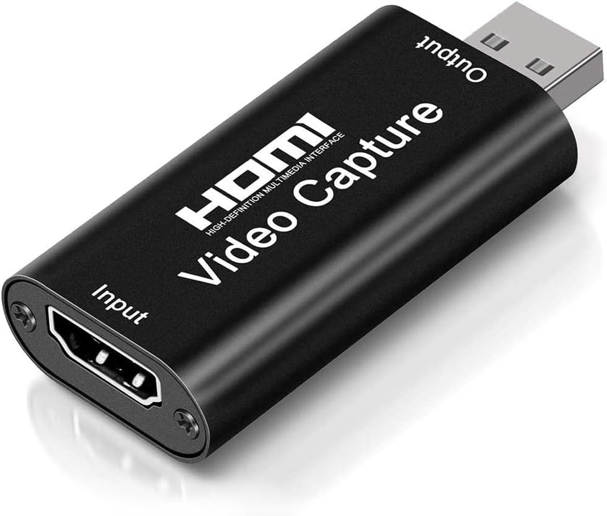

# HDMI In for Android

Turns an Android phone into an HDMI monitor using a generic USB 2.0 / USB-C HDMI
capture card. UVC (USB Video Class) is used; it acts like an external camera being 
plugged into the phone (like FLIR dongles, USB boroscopes, USB microscopes, etc.)
Usually found online at your drop-shipper of choice for ~$10 USD; Amzn/AliEx/Wlmt+

In reality it is no different than many other options where you have to pay 
some amount to use the software (because you have to buy a $10 piece of hardware).
But it is different in that it's not tied to Windows needing to run companion 
software, or that it doesn't utilize something built into the Google, Samsung, or
proprietary offerings on your phone.

Raspi project needs a display just for setup? Play on a gaming console in a pinch?
Grab files off that old laptop with a busted display for grandma? Use your phone
at work as a second monitor without upsetting IT? Turn an old phone into a monitor
for your digital camera? I think you get it.

## Using it

- Plug the capture card into the phone's USB-C port, then open the app (or accept
  the 'open with HDMI IN Android' prompt). Allow camera and USB access when asked.
  (this is because it thinks this is an external camera, your hardware cameras
  have nothing to do with the software, but you will most likely see the 'Camera
  on/recording indicator Android presents in the notification bar because of it).
- The app picks the best mode automatically*: the largest picture up to 1080p that
  runs at least 24/30fps. 1080p60 is supported if your capture card supports it.
  *What it's thinks is the best. More of a 'bigger number better' situation.
  1080p @ 30fps is probably going to to be the best option unless your hardware
  is better.
- Tap the screen to show or hide the controls:
  - **Mode**: choose any resolution / frame rate / the format the card reports.
  - **Audio**: plays the card's HDMI audio through the phone (needs microphone
    permission; many cards send audio as a USB microphone). Your capture card is
    the audio driver, so the output via your phone will most likely be in mono,
    and/or at a low bit rate. If it sounds like it's peaking or distorted, swap
    video modes (typically only after first connection).
- The top-left label shows the active mode when the overlay is on.

## Limitations

- **8-bit only.** The UVC library used here used MJPEG and 8-bit YUV. 10-bit
  capture is not supported by the library, and USB 2.0 cards can't carry it anyway.
- **USB 2.0 cards** deliver 1080p30 (sometimes 1080p60) as MJPEG. Uncompressed
  video on USB 2.0 is limited to roughly 720p or lower.
- The phone needs USB host (OTG) support over USB-C (Which should be everything
  after 2011 and Android 3.1).
- The card must be UVC-compliant. Cards that report a vendor-specific USB class
  (rather than the standard video class) will not be detected. _Cheaper = better._
- Latency is typically around 60-100 ms, depending on the card and phone;
  it is a viewer, you're not playing any FPS's with this. But, to each their own.
- It *should* work with USB 3.X Capture devices, but your mileage may vary. I
  had only tested it on a similarly cheap 3.0 devices, and it had some stuttering
  and horizontal sync issues (a green transparency of what's already on screen,
  flickering in the middle of the screen) 🤷‍♂️
  
## Credits

- [UVCAndroid](https://github.com/shiyinghan/UVCAndroid)
- Apache 2.0.
- Thought up by a human; hard (free) work done by an AI.
