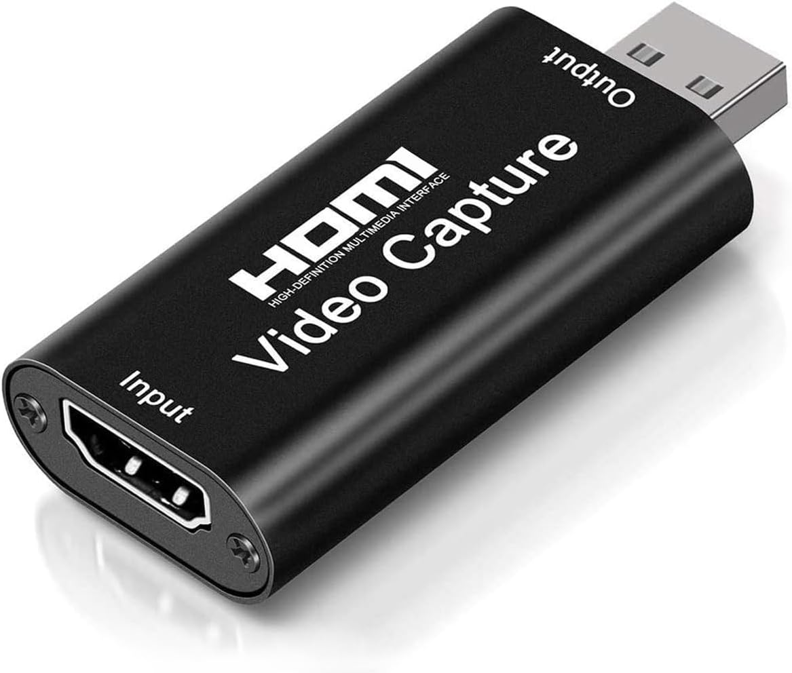

# HDMI Monitor (Android)

Turns an Android phone into an HDMI monitor using a generic USB 2.0 / USB-C UVC
HDMI capture card. Plug the card into the phone, plug your HDMI source into the
card, and the picture appears full screen. Resolution choices available.

## Using it

- Plug the capture card into the phone's USB-C port, then open the app (or accept
  the "open with HDMI Monitor" prompt). Allow camera and USB access when asked.
- The app picks the best mode automatically: the largest picture up to 1080p that
  runs at 24 fps or more, then the highest frame rate (so 1080p60 is chosen if the
  card offers it, otherwise 1080p30).
- Tap the screen to show or hide the controls:
  - **Mode**: choose any resolution / frame rate / format the card reports.
  - **Audio**: plays the card's HDMI audio through the phone (needs microphone
    permission; many cards expose audio as a USB microphone).
- The top-left label shows the active mode.

## Limitations

- **8-bit only.** The UVC library used here exposes MJPEG and 8-bit YUV. +10-bit
  capture is not supported by the library, and USB 2.0 cards cannot carry it anyway.
- **USB 2.0 cards** deliver 1080p30 (sometimes 1080p60) as MJPEG. Uncompressed
  video on USB 2.0 is limited to roughly 720p or lower.
- The phone needs USB host (OTG) support over USB-C.
- The card must be UVC-compliant. Cards that report a vendor-specific USB class
  (rather than the standard video class) will not be detected.
- Latency is typically around 100 ms or more, depending on the card and phone;
  it is a viewer, not a gaming monitor.

## Credits

Camera access uses [UVCAndroid](https://github.com/shiyinghan/UVCAndroid)
(`com.herohan:UVCAndroid`), Apache 2.0.
